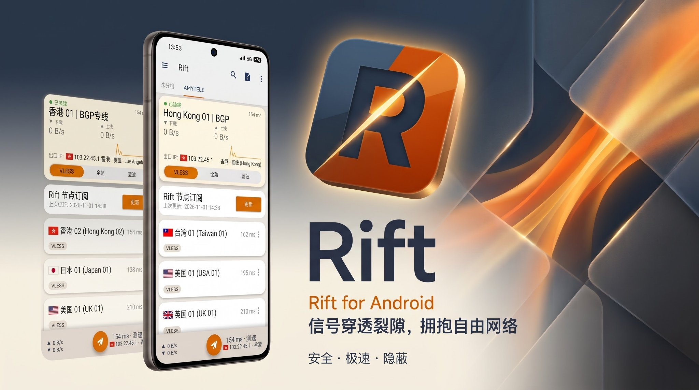

# 🌌 Rift

**只做自己喜欢的代理软件：紧跟上游 sing-box 1.15 做兼容修复。**

---

## 💡 项目初衷

我想要一款合心意的代理软件，找来找去没找到，索性自己做了一个。

Rift 是从 NekoBoxForAndroid 分叉出来的，留了它干净的样子，核心换成官方 sing-box 1.15，补上了 XHTTP。

别的项目的功能，不因为能做就盲目搬进来；**够用、干净、自己用得顺手**，是 Rift 唯一的取舍标准。

本软件由 AI 与作者人机合作完成。

---

## ✨ 核心特性

* **订阅管理**：支持自动或手动更新订阅，流量消耗与到期时间直观显示在订阅卡片上。
* **灵活分流**：支持 规则 / 全局 / 直连 模式；支持按应用分流；内置绕过中国大陆规则集（内置于包内，免去额外下载）；支持自定义直连、代理、屏蔽规则及广告拦截。
* **用量统计**：提供今日、本期（自定义结算日）、最近 30 天的流量统计，以及每个节点的详细流量消耗明细。
* **常驻通知**：通知栏实时显示当前网速、本次与今日流量，支持在通知栏直接切换分流模式，无需频繁打开 App。
* **自动备份**：支持 WebDAV 手动上传，或在配置修改 5 分钟后自动同步备份，默认保留最近 5 份。
* **连接与日志**：支持实时查看每一条活跃连接，内核日志可在侧边抽屉菜单中随时调阅。
* **双模运行**：支持标准的 VPN 模式，或仅开启本地代理端口（不接管整机流量）。
* **快捷磁贴**：支持下拉菜单快捷开关，点一下连接，再点一下断开。
* **节点导入**：支持订阅链接复制、扫描二维码、剪贴板粘贴等多种便捷导入方式。

---

## 🛠 支持协议

* **原生支持**：VLESS（已完美接入 REALITY、XHTTP）、VMess、Trojan、Shadowsocks、SOCKS、HTTP、SSH、ShadowTLS、AnyTLS、Hysteria2、TUIC。
* **说明**：WireGuard 已在 sing-box 1.15 中移除，因此本项目不再包含。

---

## 🎯 我们的取舍（图什么）

* 够用就行，绝不盲目堆砌功能。
* REALITY 可连最新 Xray，ML-KEM 握手正常通过。
* 规则集内置于安装包，更新需手动触发；更新前会进行校验，并保留旧版以便随时回滚。
* **真机实测**：VLESS + REALITY、Hysteria2、链式 XHTTP、AnyTLS 均经过真机实测；其余协议主要依赖框架与核心层支持，未逐一深度测试。

---

## 📥 下载

* 正式版与预览版均可在 [Releases](releases) 页面获取。
* 预览版将标有 `Pre-release` 标签，具体变更请参考对应的 Release 说明。

---

## 🚀 快速上手

1. 点击右上角 **「+」**，通过订阅链接、二维码或剪贴板将节点导入。
2. 点击选中一个节点，点击 **「重测」** 检查当前延迟。
3. 点击底部中央的圆形按钮建立连接（首次使用会请求 VPN 权限）。
4. **日常配置建议**：
   * **国内直连**：将分流切至「规则」，并开启「绕过中国大陆」。
   * **部分代理**：若只想让特定应用走代理，请前往路由设置中按需勾选。

---

## ⚠️ 注意事项

部分机场的订阅链接存在几分钟极速失效的限制。若遇到订阅过期导致更新失败，属于机场侧限制，并非 Rift 的问题。

---

## 🙏 鸣谢

感谢以下优秀开源项目，请同时尊重其许可证与原作者署名：

* [NekoBoxForAndroid](https://github.com/MatsuriDayo/NekoBoxForAndroid) (MatsuriDayo)
* [sing-box](https://github.com/SagerNet/sing-box) (SagerNet)
* [OwnBoxForAndroid](https://github.com/Own716/OwnBoxForAndroid) (Own716)
* [NextBox-Android](https://github.com/Efah-Dev/NextBox-Android) (Efah-Dev)
* [Xray-core](https://github.com/XTLS/Xray-core)（内部传输代码）
* Squircle IDE（Apache-2.0，键盘与菜单组件）
* stun（Cong Ding，Apache-2.0）
* [Shadowsocks](https://github.com/shadowsocks/shadowsocks-android)（Max Lv / Mygod）
* Google（Apache-2.0，图标资源）

---

## 📄 许可证

本项目采用 [GPL-3.0](LICENSE) 许可证。
